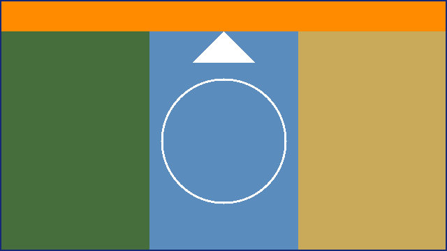

# fumi v2 ローカル画像の手動デバッグ

リポジトリの直下から開く。画像は `images/` にあり、この文書の所在ディレクトリを基準に読む。

```sh
fumi docs/examples/manual-images.md
fumi --color never docs/examples/manual-images.md
fumi --plain docs/examples/manual-images.md
```

- 通常表示: 対応端末ではステータスがKITTYになり、表示対象の画像が本文から分かれた行に出る。代替テキストと参照先は画像の下に残る。
- 色なし: 本文の色は消えるが、画像は通常表示と同じ色のまま。
- plain・非対応端末: 照会も転送もせず、画像はすべて文中の `[image: 代替テキスト] <参照先>` のまま。理由のラベルも付かない。
- 画像の目印: 上側の橙の帯と白い上向きの矢印（向き）、中央の白い真円（縦横比）、紺の枠線（縁の切れ）。
- 記録: 項目番号、OS、端末とバージョン、フォントとサイズ、画面サイズ、tmux/SSHの有無。

## 01 PNGとJPEGの表示

チェック: 3枚とも表示され、橙の帯と矢印が上、円が丸い。画像の上下の本文が別の行に分かれ、行頭・行末に空白が残らない。

文中のPNG  の前後で本文が分かれる。



### 見出しの画像 

## 02 縮小と縦横比

チェック: 横長は本文幅に、縦長は12行に収まり、どちらも円が楕円にならない。小さな画像（24×24画素）は拡大されず小さいまま。


## 03 透過PNG

チェック: 四角い板が見えず、外側の青い輪の内外から端末の背景が見える。中央の赤い円は半透明で、背景の色が混ざる。端末の背景を半透明にしたり背景画像を付けたりして確かめる。


## 04 EXIFの向き

チェック: 縦長で表示され、橙の帯と矢印が上に来る。ファイルの画素は横長で保存され、EXIFの向き6（時計回りに90度）で縦長に戻る。


## 05 ファイル名と参照の書き方

チェック: どれも表示される。拡張子が `.jpg` でも中身がPNGなら表示する。`%20` は空白に戻す。強調の中の画像も表示する。連続する画像の間に空行ができない。


*強調の中の画像 *


## 06 代替テキストのまま表示するもの

チェック: どれも画像にならず、文中の代替テキストと参照先のまま。理由のラベルも付かない。Web上の画像を取得しない。

- リストの中 

> 引用の中 

| 表の中 |
|---|
|  |

[](https://example.invalid/link)


## 07 表示できない画像の理由

チェック: どれも代替テキストと参照先の行の下に、括弧内の理由が出る。文書全体は読める。

ないファイル（ファイルが見つかりません）:


アニメーションPNG（アニメーション未対応）:


GIF（形式未対応）:


拡張子だけPNGのテキスト（形式未対応）:


署名だけ正しい壊れたPNG（画像が壊れています）:


6000×6000画素を名乗るPNG（25メガピクセル上限）:


ディレクトリ（通常ファイルではありません）:


## 08 スクロール・検索・ヘルプ・リサイズ

チェック: 画像が画面の上端・下端にかかる状態で `j`/`k` を連打し、残像・重複・ステータス行へのはみ出しがない。`/SCROLL_TARGET` の検索で画像の前後へ移動しても崩れない。画像の途中でヘルプを開閉し、リサイズし、`Ctrl+z`/`fg` で中断・復帰しても同じ位置で表示される。tmuxでもペインの分割・移動・ズームで別のペインに画像が残らない。

この段落はスクロールの余白。SCROLL_TARGET_BEFORE。画像の上の本文が画面の上端を越えるまで移動する。


この段落はスクロールの余白。SCROLL_TARGET_BETWEEN。二つの画像の間で画面の上端・下端を往復する。


この段落はスクロールの余白。SCROLL_TARGET_AFTER。画像の下の本文が画面の下端にかかるまで移動する。

## 09 数式との混在

チェック: 数式と画像の両方が表示され、順序が崩れない。端末が文字色・背景色に応答しない場合は、数式だけが `[math: 文字色不明]` になり、画像は表示される。

$$ \frac{1}{2} + \sqrt{x} $$


$$ \sum_{i=1}^{n} i $$

## 10 再読込

リポジトリのファイルを書き換えないよう、作業用のディレクトリへコピーして試す。

```sh
cp -R docs/examples /tmp/fumi-images
fumi --watch /tmp/fumi-images/manual-images.md
```

チェック: 別の端末で `cp /tmp/fumi-images/images/photo.jpg /tmp/fumi-images/images/landscape.png` のように画像を差し替えても、それだけでは表示は変わらない（画像は監視しない）。その後 `R` を押すか、この文書を保存し直すと新しい画像になる。画像を消して `R` を押すと、理由が `ファイルが見つかりません` に変わる。

## 11 末尾

チェック: `G` で末尾へ移動し、最後の画像の下の代替テキストまで読める。


